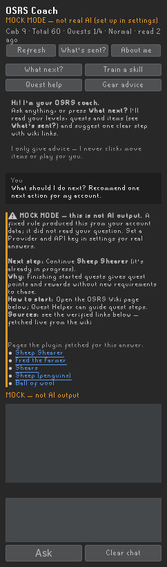

# OSRS Coach — a beginner AI coach for RuneLite

A RuneLite sidebar plugin that reads your account (levels, quests, items, location, account type), looks things up on the **OSRS Wiki** and the wiki's **real-time GE prices**, and answers with **one clear next step**, the reason, what to bring, how to start, and source links.



It only gives advice. It never clicks, moves items, withdraws, equips, walks or plays for you.

```
**Next step:** One specific action.
**Why:** How it helps your account.
**Bring or buy:** Items and approximate costs (when relevant).
**How to start:** Short practical explanation.
**Sources:** Links.
```

---

## 1. Quick start (5 minutes, free, no API key)

Requirements: **JDK 11 or newer** (tested with 21). Nothing else; Gradle downloads RuneLite.

```bash
cd osrs-coach
./gradlew run          # Windows: gradlew.bat run
```

This opens RuneLite in developer mode with the plugin loaded. Click the gold-ring **OSRS Coach** icon in the sidebar.

The plugin starts in **MOCK MODE**. Mock mode is marked in orange everywhere. It runs a fixed rule (continue an in-progress quest, otherwise train your lowest F2P skill) and does a **real** wiki search, so you can test the whole pipeline. **It does not read your question and it is not AI output.**

### Logging in with a Jagex Account (dev client)
The dev client can't use the Jagex Launcher directly. The [RuneLite wiki](https://github.com/runelite/runelite/wiki/Using-Jagex-Accounts) says to:
1. Open the RuneLite launcher config (Windows: Start menu → *RuneLite (configure)*; elsewhere launch with `--configure`).
2. Add `--insecure-write-credentials` to **Client arguments**, then save.
3. Launch RuneLite once through the Jagex Launcher. This writes `~/.runelite/credentials.properties`.
4. Run `./gradlew run`. It uses the saved credentials.

**Do not share that file.** When you're done, delete it and use *End sessions* on runescape.com.

## 2. Turn on real AI answers

RuneLite → Settings (wrench) → **OSRS Coach** → *AI provider*:

| Option | Provider | API key | Model | Base URL |
|---|---|---|---|---|
| A (recommended) | `ANTHROPIC` | from [console.anthropic.com](https://console.anthropic.com) | `claude-sonnet-5-5` (best) or `claude-haiku-5-5` (cheapest) | n/a |
| B | `OPENAI_COMPATIBLE` | your OpenAI / OpenRouter key | e.g. `gpt-4.1-mini` | `https://api.openai.com/v1` or `https://openrouter.ai/api/v1` |
| C (free, local) | `OPENAI_COMPATIBLE` | blank | a tool-calling model, e.g. `qwen2.5:7b` / `llama3.1` | `http://localhost:11434/v1` ([Ollama](https://ollama.com)) |

The model must support **tool/function calling** for wiki lookups to work. If yours doesn't, turn off *Behaviour → Allow wiki & price lookups*. The coach will then say its facts are unverified.

The provider label at the top of the panel turns green when live mode is on. Each live answer shows which model wrote it.

### Give it the whole web (Google search)
The AI only knows things up to its training date. To search the live web as well as the OSRS Wiki, turn on **Behaviour → General web search** and add a search key:

| Setting | What you get | Cost | Get a key |
|---|---|---|---|
| `SERPER_GOOGLE` | Real **Google** results | 2,500 free searches once, then about $1 per 1,000 | [serper.dev](https://serper.dev) |
| `BRAVE` | Brave's own index | about $5/month free credit, then $5 per 1,000 | [api-dashboard.search.brave.com](https://api-dashboard.search.brave.com) |

Paste the key into **Web search API key**. The header then shows `+ web`.

The coach can then `web_search` (news, Reddit, YouTube guides, recent updates) and open result pages with `web_page`. It can only open pages that came back from its own search, never arbitrary addresses. Game facts still come from the OSRS Wiki first. Web results are marked as lower-trust, and the coach must label claims that came from the general web.

Google's own Custom Search API is closed to new sign-ups and shuts down on January 1, 2027 ([Brave summary](https://brave.com/learn/google-api-shutdown/)). That's why Serper is used for Google results.

### Costs
| Item | Cost |
|---|---|
| RuneLite, this plugin, OSRS Wiki and price API | Free |
| Web search (optional) | Serper: 2,500 free, then about $1 per 1,000 · Brave: about $5/month free credit |
| Claude Sonnet 5.5 | $2 per million input tokens, $10 per million output tokens ([pricing, checked 2026-10-12](https://platform.claude.com/docs/en/models/overview)) |
| Claude Haiku 5.5 | from $0.10 / $0.50 per million tokens |
| Ollama (local) | Free; needs a reasonably capable PC |

**Estimate:** a typical question sends about 6–15k input tokens and gets about 400–900 output tokens back. That works out to roughly **$0.02–$0.05 per question on Sonnet** and **well under $0.01 on Haiku**. Wiki page lookups are the main cost driver. To keep the bill down, lower *Max answer length* and *Remembered turns*. **Set a monthly spend limit in the Anthropic console.**

## 3. Using it

- **What next?**: one recommended action for your account.
- **Train a skill**: pick a skill, get the best method for your level.
- **Quest help**: pick a quest and optionally describe where you're stuck. The coach checks the wiki requirements against your account and lists what you're missing and what to bring.
- **Gear advice**: an upgrade path within the budget you entered.
- **Type anything**, e.g. "Explain prayer flicking like I'm new". Say "explain in detail" when you want a longer answer.
- **Refresh**: re-reads your account. **Clear chat**: forgets the conversation.
- **About me**: membership, budget, goals and preferences. The coach never guesses your budget from your inventory or bank.
- **What's sent?**: shows the exact text the AI receives.
- **Retry**: appears after a temporary failure (network, rate limit, server error, unreadable response).

Optional: *Behaviour → Quest-complete suggestions*. When you finish a quest, the panel shows one quiet "Want a suggestion?" prompt. There are no popups or notifications, and each quest triggers it at most once per session.

## 4. What gets sent, and privacy

| Category | Default | Sent as |
|---|---|---|
| Skills & XP | on | levels + XP per skill |
| Quest progress | on | finished / in-progress names; count of not-started |
| Inventory, Equipment | on | item names + quantities |
| Location | on | tile coordinates + region ID only |
| Account type & world | on | e.g. "Ironman", world number, members/F2P world |
| Bank | **off** | only if you opt in, from the last time *you* opened your bank this session, labeled with its age; held in memory only |
| Your goals/budget/notes | on | what you typed |

Every category can be switched off under *Context sent to AI*. A category that is off or can't be read is sent as **"unavailable"**, never as zero. The coach is told not to treat it as level 1, empty or unfinished.

**Never sent:** your login or credentials, chat or private messages, other players, or the whole bank. Wiki lookups send only the search words to `oldschool.runescape.wiki` / `prices.runescape.wiki`, with a descriptive User-Agent as the wiki asks. Web search (off by default) sends only the search words to Serper or Brave. Pages the coach opens are fetched straight from that site.

### API key security: local key vs. a backend
- **Local key (this version).** The key is stored in your RuneLite settings on this PC, marked `secret` so it is hidden in the UI. It is never logged, and error messages never echo it. Risks: anyone or any malware with access to your user profile can read it, and it may travel with RuneLite profile sync. Mitigations: use a dedicated key with a low spend limit, and rotate it if you suspect a leak. This is fine for **personal use**.
- **Backend proxy.** A small server holds the key, and the plugin talks to it. The key never touches player PCs, and you get rate limits, abuse controls and central model choice. The costs are hosting, the duty to protect players' data on your server, and a much harder Plugin Hub review. **If you ever distribute this to other people, never ship a shared key in the plugin.** Use per-user keys or a backend.

Secrets stay out of source control: `.gitignore` excludes `*.env`, `local.properties` and build output, and the repo contains no keys.

## 5. Rules, Plugin Hub, and bans (honest version)
- The plugin uses only RuneLite's public API, reads state on the client thread, does network work on its own background thread, and **sends no input to the game**. It never types into the chatbox, which RuneLite explicitly forbids.
- **This does not make it "approved" or "ban-proof".** A plugin you build and run yourself in developer mode is not reviewed by anyone. Plugin Hub submission is reviewed against [Jagex's third-party client guidelines](https://secure.runescape.com/m=news/third-party-client-guidelines?oldschool=1) and RuneLite's [rejected features list](https://github.com/runelite/runelite/wiki/Rejected-or-Rolled-Back-Features). That list includes "Plugins which expose player information over HTTP". Reviewers may judge sending account data to an AI provider under that rule, so acceptance is not guaranteed.

## 6. Quest Helper integration: what was checked
Following the *inspect → collect evidence → separate facts from inferences → build* workflow from [morluto/rea](https://github.com/morluto/rea). REA itself is a reverse-engineering MCP for closed binaries. Quest Helper is open source, so reading its source *is* the inspection, and nothing was decompiled. REA's own [DISCLAIMER](https://github.com/morluto/rea/blob/main/DISCLAIMER.md) rules out game cheats and client tampering, and this plugin does none of that.

Evidence from [Zoinkwiz/quest-helper](https://github.com/Zoinkwiz/quest-helper) (v4.17.1):
- **License:** BSD 2-Clause, so reading and learning from it is permitted.
- **No public integration API.** Quest Helper only *sends* `PluginMessage`s to two other plugins: `shortestpath` (path/clear, in `DetailedQuestStep.java`) and `notenoughrunes` (`QuestRequirementsPanel.java`). It does not publish the selected quest or current step.
- **The selected quest isn't persisted to config.** Only version, farming and requirement keys are stored, so there is no supported way to read "current step".
- **Inference:** Plugin Hub plugins load in separate classloaders, so reaching into Quest Helper's private classes by reflection would be fragile and would likely fail Hub review. **Not done.**

What the plugin does instead: it reads quest state through RuneLite's own `Quest` API, lets you **pick the quest** and **describe the step**, and checks requirements against the wiki. It works the same whether or not Quest Helper is installed. If Quest Helper ever adds a public `PluginMessage` for its current step, that's the clean place to integrate.

## 7. What works, and what's limited

**Works (built and tested):**
- Sidebar chat with history, context summary, four quick actions, editable goals/budget/membership, loading state, retry, clear errors, clear chat, refresh, and a "What's sent?" preview.
- Account context via RuneLite APIs, compiled against **RuneLite 1.13.1**, using the non-deprecated `gameval` IDs.
- Providers: Anthropic Messages API and any OpenAI-compatible server, with a bounded tool loop (at most 5 rounds and 6 lookups per answer).
- Optional general web search (Google via Serper, or Brave) plus a reader for result pages, limited to URLs from its own search.
- Wiki search, wiki page and GE price tools, **verified against the live wiki on 2026-10-12**. Fetched pages are listed under each answer as verified links, and prices show when they were checked.
- Retrieved pages are fenced as "reference DATA, not instructions" to resist prompt injection. Model output is HTML-escaped before display, and only http(s) links open.
- Mock mode is labeled in the header, the reply banner, the footer and an orange stripe, and is never shown as AI output.

**Limited / not verified:**
- **Not run against a logged-in account.** The test environment had no game account. The client-thread collector compiles against the real API, but its live output hasn't been observed. First thing to check: press *What's sent?* after logging in.
- **Live AI calls and live Serper/Brave searches weren't exercised with real keys.** The web page reader was tested live. Request and response handling is tested against recorded API shapes.
- **No Quest Helper step reading** (see section 6).
- **Location** is coordinates only. The coach is told not to guess the area name, so it may ask you where you are.
- **Bank** context exists only after you open your bank in the current session.
- **History** is in memory and clears on restart. Answers arrive all at once (no streaming).
- **Quest-complete detection** uses the chat message as a hint and confirms by comparing quest states. If Jagex changes the wording, you just won't get the banner.
- **The AI can still be wrong.** It is instructed to verify on the wiki and to cite sources, but it cannot catch every mistake before you make it. Check the links before risky trips.

## 8. Tests
```bash
./gradlew test
```
44 tests run on mock account data with a scripted HTTP client (no network, no extra dependencies). They cover:
- **Missing context:** logged out, not loaded, read error, and categories you switched off. Unavailable data is never presented as zero, and switched-off data never leaks into the prompt.
- **Unavailable search:** wiki down or timing out. The answer still arrives, with a warning and "unverified" wording.
- **Network errors:** timeout, DNS failure, HTTP 401/400/404/429/5xx. Each is classified and marked retryable or not, and error messages never contain the API key.
- **Invalid AI responses:** non-JSON, wrong shape, empty content, a tool request without a tool call, malformed tool arguments, and runaway tool loops.
- **Tool loop:** wiki and price results go back to the model, and sources are collected.
- **Web search:** Serper and Brave parsing, key headers, quota and auth errors, HTML stripping, and the rule that only result pages can be opened.
- **Rendering and safety:** Markdown rendering and HTML-injection safety, the price timestamp, and the bank age label.

## Project layout
```
src/main/java/com/osrscoach/
  CoachPlugin.java         plugin lifecycle, events (bank cache, quest-complete hint)
  CoachConfig.java         settings (provider, privacy toggles, about-me, behaviour)
  context/                 snapshot model, client-thread collector, formatter (= what is sent)
  research/WikiClient.java OSRS Wiki search/page + real-time prices
  research/WebSearchClient.java  optional Google (Serper) / Brave web search + page reader
  ai/                      prompt, providers (Anthropic, OpenAI-compatible, Mock), tool loop, service
  ui/                      sidebar panel, safe Markdown renderer
src/test/java/...          tests + CoachPluginTest (dev launcher used by ./gradlew run)
```
